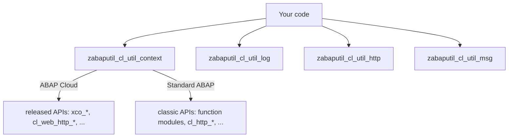

# Architecture

`abap-util` is intentionally simple: one context class with all static helpers plus a handful of focused helper classes.

## Repository Layout

```
src/
├── zabaputil_cl_util_context      ← the master utility class (static helpers)
├── zabaputil_cl_util_http         ← HTTP handler abstraction
├── zabaputil_cl_http              ← HTTP helper
├── zabaputil_cl_util_db           ← key/value persistence (table zabaputil_t_91)
├── zabaputil_cl_util_log          ← fluent log builder
├── zabaputil_cl_util_msg          ← message extractor
├── zabaputil_cl_util_range        ← range / SQL builder
├── zabaputil_cl_util_xml          ← fluent XML builder
├── zabaputil_cx_util_error        ← exception raised by the library
├── zabaputil_cx_error             ← no-check exception
└── 00/
    ├── 01/                        ← embedded ajson
    └── 02/                        ← embedded S-RTTI
```

## One Class, Three Targets

Almost every call goes to `zabaputil_cl_util_context`. The class compiles on NetWeaver 7.02, Standard ABAP and ABAP Cloud from one source: where an API exists in only one environment, the method branches at runtime with `check_abap_cloud( )` and reaches the environment-specific API through a dynamic call. Your calling code stays the same everywhere.



A few methods have no ABAP Cloud counterpart at all (long texts, MIME repository, spool, forms, variants, AMC, GOS, `rfc_call_dynamic`). They raise `zabaputil_cx_util_error` on ABAP Cloud — see [Cloud vs. On-Premise](./cloud-vs-onprem).

## Bundled Dependencies

Two community libraries are vendored into the `00/` subpackage so you don't have to install them separately:

- [**ajson**](https://github.com/sbcgua/ajson) — JSON serialization (`00/01/`)
- [**S-RTTI**](https://github.com/sandraros/S-RTTI) — RTTI persistence (`00/02/`)

Vendoring keeps the dependency graph flat and avoids version drift across consumer projects.

## Consumption Model — Copy, Don't Depend {#consumption-model}

abap-util is meant to be consumed **as a renamed copy, not as an installed dependency**. abapGit has no dependency management, so a hard dependency would force every user to install packages in the right order and keep versions in sync. Instead, this repository is the **master catalog with all utility classes and all methods**, and every project embeds a renamed copy of exactly the classes it needs. Only the context class is additionally **trimmed to the methods the project uses**, together with the helpers they call.

| Project | Copies | Scope |
| --- | --- | --- |
| [abap2UI5](https://github.com/abap2UI5/abap2UI5) | `z2ui5_cl_ui5_util_context`, `z2ui5_cl_ui5_util_http`, `z2ui5_cx_ui5_util_error` (`src/00/03/`) | context class trimmed to the methods of the core framework, the other two as-is |
| [popups](https://github.com/abap2UI5-addons/popups) | `z2ui5_cl_popup_context`, `z2ui5_cx_popup_error` (`src/00/`) | context class trimmed to the methods of the popup apps, the exception as-is |
| [business-api](https://github.com/abap-util/business-api) | `zabaputil_cl_bus_util_context`, `zabaputil_cl_bus_util_msg`, `zabaputil_cx_bus_util_error` (`src/00/`) | context class trimmed to what the message class and the exception need, the other two as-is |

Every consumer installs with zero dependencies and keeps its own namespace — several projects, even on different versions, coexist in one system. abap-util stays the place where all methods converge, are unit-tested and are kept compatible with every release:

- **Copy per class** — a project takes the classes it needs and renames them into its own namespace. The copy rule inserts the consumer's segment: business-api inserts `bus_`, so `zabaputil_cl_util_context` becomes `zabaputil_cl_bus_util_context` and `zabaputil_cx_util_error` becomes `zabaputil_cx_bus_util_error`.
- **Develop locally** — a method a project needs is written into its own copy first, no upstream detour.
- **Sync back** — what was added or fixed in a copy is merged back here regularly, so this catalog stays the superset and every other consumer can pick it up. Fix it here, then update the copies.

Not every class next to a copy has a master here: `z2ui5_cl_ui5_util_json_fl` is owned by abap2UI5, and abap2UI5's `src/99/01/` holds frozen copies from before this model that receive no fixes. Neither is a source for the sync.

To install the **whole** library under another name instead of copying single classes, use the [rename workflow](./renaming).

## Build & Test

The repo carries everything needed to lint, downport, rename and run the unit tests without an SAP system:

```bash
npm ci
npm run lint            # abaplint, Standard ABAP (v750)
npm run lint:cloud      # abaplint, ABAP Cloud
npm run downport        # rewrite src/ to 7.02 syntax - what auto_downport pushes to 702
npm run auto_transpile  # transpile to JavaScript
npm run unit            # run the unit tests in Node.js
npm run rename          # rename every object to the longest prefix allowed
```

| Workflow | Runs on | Purpose |
| --- | --- | --- |
| `ABAP_STANDARD`, `ABAP_CLOUD`, `ABAP_702` | pull request | abaplint for each target |
| `test_unit` | pull request | unit tests transpiled to JavaScript |
| `test_rename` | pull request | every object still lints under a renamed prefix |
| `auto_downport` | push to `main` | pushes the 7.02 downport to the branch `702` |
| `build_rename` | manual | builds a renamed copy on the branch `rename_<name>` — see [Renaming](./renaming) |
