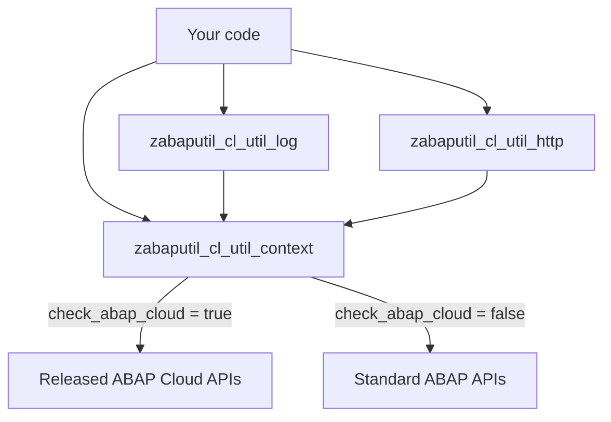

# Architecture

`abap-util` is intentionally simple: a single façade class plus a handful of focused helper classes.

## Repository Layout

```
src/
├── zabaputil_cl_util_context      ← main façade (static helpers)
├── zabaputil_cl_util_http         ← HTTP handler abstraction + HTTP client
├── zabaputil_cl_util_db           ← key/value persistence (table zabaputil_t_91)
├── zabaputil_cl_util_log          ← fluent log builder
├── zabaputil_cl_util_msg          ← message extractor
├── zabaputil_cl_util_range        ← range / SQL builder
├── zabaputil_cl_util_xml          ← fluent XML builder
├── zabaputil_cl_http              ← HTTP helper
├── zabaputil_cx_util_error        ← custom exception
├── zabaputil_cx_error             ← no-check exception
└── 00/
    ├── 01/                        ← embedded ajson (mirrored from upstream)
    └── 02/                        ← embedded S-RTTI (mirrored from upstream)
```

## Façade Pattern

99 % of consumers only ever call methods on `zabaputil_cl_util_context`. There are no separate adapter classes: release-specific behavior is branched inside the methods via `check_abap_cloud( )` and dynamic calls, so the same class activates on ABAP Cloud, Standard ABAP and (via the `702` branch) NetWeaver 7.02.



Your calling code stays untouched.

## Bundled Dependencies

Two community libraries are vendored into the `00/` subpackage so you don't have to install them separately:

- [**ajson**](https://github.com/sbcgua/ajson) — JSON serialization
- [**S-RTTI**](https://github.com/sandraros/S-RTTI) — RTTI persistence

Vendoring keeps the dependency graph flat and avoids version drift across consumer projects.

## Build & Test

The repo carries everything needed to build a downport and run the unit tests offline:

| File | Purpose |
| --- | --- |
| `abaplint.jsonc` | Lint configuration shared with downstream projects |
| `package.json` | npm scripts (`downport`, `auto_transpile`, `unit`) |
| `node/` | Transpiler workspace (generated, gitignored output) |
| `.github/workflows/` | CI matrix for cloud, standard, 7.02 and unit tests |

The `auto_downport` workflow uses [abaplint](https://abaplint.org) to rewrite modern syntax for the `702` branch.

## Embedding into another product

If you maintain your own framework and want to ship `abap-util` inline without colliding with the `zabaputil_` prefix, copy the classes you need and rename them into your own namespace. To install the whole library under another name, run the [`build_rename`](https://github.com/abap-util/abap-util/actions/workflows/build_rename.yaml) workflow, which pushes a renamed copy to the branch `rename_<name>`. The `rename` npm script checks that every object still lints under a longer prefix:

```bash
npm run rename
```

The upstream project [abap2UI5](https://github.com/abap2UI5/abap2UI5) embeds renamed copies of `zabaputil_cl_util_context`, `zabaputil_cl_util_http` and `zabaputil_cx_error` this way.
